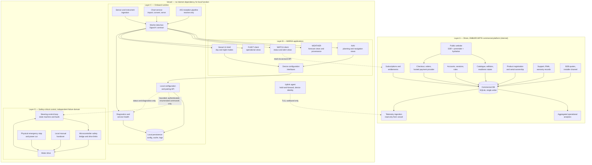

# MAREA — Target commercial architecture and boundaries

Date: 2026-10-30
Milestone: MC-02 (technology, IP, licensing and commercial-reuse audit), deliverable E-2
Status: TARGET ARCHITECTURE — DESIGN ONLY. Nothing in this document is implemented, approved,
certified or sale-ready.
Seller and contractual party: EMBARCARTE. Proposed brand: MAREA. Technical origin: OPEN-MARINE (OMI).

**Standing statement.** This document defines boundaries for later milestones. It proposes no rewrite,
no new microservice and no speculative platform. It does not authorise copying OPEN-MARINE code
(DECISION-LOG D-002), does not grant data or chart rights, and does not create a purchasable SKU or a
certification claim. Where evidence is missing the item is marked `BLOCKED` rather than designed around.

---

## 1. Document control

| Field | Value |
|---|---|
| Subject revisions | EMBARCARTE `feature/marea-mc02-technology-audit`; OPEN-MARINE `403941b8860439115418b1786d8431284d2dae08` |
| Depends on | `MAREA-PRODUCT-REUSE-MAP.md` (this milestone, deliverable E-1); companion audit documents |
| Scope | Target component boundaries, data/authority model, Signal K decision, weather and chart data architecture, AIS pipeline boundary, WATCH/FLEET connectivity, reuse-vs-build decisions, anti-goals |
| Out of scope | Implementation, procurement, pricing, certification strategy, legal opinions, trademark clearance |
| Writable scope | This file only |
| Review status | Independent review required; reviewer must test each boundary rule against cited evidence |

### 1.1 Citation codes

Same codes as `MAREA-PRODUCT-REUSE-MAP.md` §1.1, restated here so this document can be reviewed alone.

| Code | Document |
|---|---|
| `CI` | `docs/marea/compliance/OPEN-MARINE-CAPABILITY-INVENTORY.md` |
| `IP` | `docs/marea/compliance/INTELLECTUAL-PROPERTY-CHAIN.md` |
| `LP` | `docs/marea/compliance/LICENSE-NOTICE-AND-DISTRIBUTION-POLICY.md` |
| `SLI` | `docs/marea/compliance/SOFTWARE-LICENSE-INVENTORY.csv` |
| `DR` | `docs/marea/compliance/MARINE-DATA-RIGHTS-MATRIX.csv` (rows `MD-01`…`MD-28`) |
| `HW` | `docs/marea/compliance/HARDWARE-COMPLIANCE-MATRIX.md` |
| `PF` | `docs/marea/COMMERCIAL-PORTFOLIO.md` |
| `WR` | `docs/marea/WEBSITE-AND-ROADMAP.md` |
| `M00` | `docs/marea/M00-DISCOVERY-BASELINE.md` |
| `M01` | `docs/marea/execution/MC-01-BASELINE.md` |
| `DL` | `docs/marea/execution/DECISION-LOG.md` |
| `A1` | `docs/marea/execution/MC-01-DELIVERY.md` |
| `AS` | `docs/marea/assets/ASSET-PIPELINE.md` |

Element ids `E-01`…`E-24` and decision statuses (`REUSE-CANDIDATE`, `REUSE-CONDITIONAL`,
`LICENSE-OR-PARTNER`, `BUILD`, `REPLACE-OR-REMOVE`, `BLOCKED`) are defined in
`MAREA-PRODUCT-REUSE-MAP.md` §2.2 and §3 and are referenced, not redefined, here.

---

## 2. Purpose, constraints and non-goals

### 2.1 Purpose

Give later milestones (MC-10 to MC-17) a reviewable boundary model for four layers that must not blur
into each other: the commercial platform, the MAREA applications, the onboard runtime and safety-critical
control. Every later design decision must be locatable in exactly one layer, with exactly one authority
for each data class.

### 2.2 Hard constraints inherited from evidence

Constraint ids are `K-n` to avoid colliding with the data-class ids `C-n` in §6.

| ID | Constraint | Source |
|---|---|---|
| K-1 | No reuse right exists for OPEN-MARINE code, firmware or documentation until a written licence/assignment exists | `IP` §0.1, §9; `DL` D-002; `LP` G-01/G-02 |
| K-2 | EMBARCARTE today is an Angular 21 SSR/prerender/hydration application with one Express 5 server and `node:sqlite`, Node >= 22 | `M01` §2 |
| K-3 | The onboard runtime is composition: a third-party Signal K container, nine systemd units and Python publishers; OMI contributes glue, not the bus | `CI` §5.1 C-02, §5.3 |
| K-4 | Every OMI service is unauthenticated and has no TLS; the autopilot control API binds `0.0.0.0` with CORS `*` | `CI` G9; `HW` F-A25 |
| K-5 | No hardware article, BOM, bench log or sea trial exists anywhere in either repository | `HW` §1.1, §2.8, §3.2 F-A28 |
| K-6 | Chart, weather and geospatial data carry provider terms; most are unresolved and some forbid offline or redistributed use | `DR` MD-01…MD-28; `LP` §11.1 |
| K-7 | NMEA 2000 requires a licence, manufacturer/product codes and NMEA certification; nothing is implemented | `HW` §4.2; `CI` C-17 |
| K-8 | AIS-catcher is GPL-3.0 and is acquired unpinned at install time | `LP` §7.1; `HW` HW-08, R-04 |

### 2.3 Non-goals

Non-goals are architectural commitments, not preferences: a later milestone that wants to cross one must
record a decision with evidence.

1. No rewrite of the EMBARCARTE application, its SSR/prerender model, its route registry or its
   server-authoritative commerce invariants (`M01` §6).
2. No microservice decomposition of the commercial platform. One Express server and one SQLite database
   remain the commercial system of record until measured load or an operational requirement proves
   otherwise.
3. No second Signal K server implementation, no fork of `signalk-server`, and no parallel vessel data model.
4. No second navigation renderer or second chart-processing pipeline.
5. No design work that depends on NMEA 2000 certification before the licence and certification decision.
6. No cloud dependency for local navigation, monitoring or control of the vessel.
7. No certification, type-approval or compliance claim in any interface, string or diagram.

---

## 3. Architectural principles

| Rule | Statement | Why it exists | Enforcement evidence required |
|---|---|---|---|
| R-A1 | The e-commerce platform must never become the real-time steering controller | Commerce availability, billing state and network latency are incompatible with control authority; `PF` §04 forbids internet-remote unattended control | No cloud-to-control path exists in code review; control interface reachable only inside the vessel boundary |
| R-A2 | Local vessel functions keep working without internet, per product design (offline-first) | NAV, instruments and local monitoring are used where connectivity is absent; `PF` §02/§07 require offline operation | Documented offline test per product (MC-13 gates) |
| R-A3 | Account and subscription logic must not create unsafe failure modes | An expired card must never remove safety-relevant local information, block local manual handover or alter control behaviour | Entitlement state machine reviewed against safety functions; degradation is presentation-only |
| R-A4 | One data contract and one bus; do not duplicate Signal K, navigation rendering or chart processing without a documented reason | `CI` §5.3 C-01/C-02: the contract is the de-duplication mechanism; `M01` §7.2 records the real boundaries | Decision record per duplicated capability, with owner and justification |
| R-A5 | Safety-critical control is a separate failure domain with physical independence | `PF` §04 requires independent watchdog, hardware E-stop, manual takeover and separate motor controller; `HW` §3.2 shows which parts are missing | `HW` §3.5 G1–G9 evidence before any PILOT claim |
| R-A6 | No speculative microservices and no speculative distributed infrastructure | Programme rule (`AGENTS.md`); no measured load evidence exists | Any new service requires a measured need plus an owner |
| R-A7 | Exactly one authoritative writer per data class | Duplicate writers are how commercial state leaks into vessel state | Data/authority table (§6) is the reference; violations found in review |
| R-A8 | Assume the onboard LAN is hostile until proven otherwise | `CI` G9 and `HW` F-A25: every service is currently unauthenticated | Onboard auth design with tests (E-21) |
| R-A9 | Licensing is an architectural constraint, not a footnote | `DR`/`LP` forbid several data flows that the current prototype performs | Data class may only enter a layer whose resolved rights permit it |
| R-A10 | Claims and evidence stay separable: every user-visible claim links to a recorded evidence item | `HW` §4.6 rules; `M00` truth model | Claim-to-evidence register per release |

---

## 4. Layer model

Four layers, four responsibility sets. Rows marked `PROTOTYPE` describe what exists in OPEN-MARINE;
they are not MAREA product components until the rights decision (K-1) is made.

### 4.1 Layer A — EMBARCARTE commercial platform

| Aspect | Content |
|---|---|
| Purpose | Sell, contract, entitle, support and account for MAREA products and the existing EMBARCARTE businesses |
| Owns | Public website (SSR/prerender), product catalogue and readiness states, checkout and orders, customer accounts and sessions, subscriptions and entitlements, product registration and ownership, support and RMA, B2B quotes and installer channel |
| Must not own | Any real-time vessel state, any steering or motor command, any authority over local navigation data, any chart/weather data redistribution |
| Current evidence | Angular 21.2 standalone + SSR/prerender + hydration, Express 5, `node:sqlite`, optional Stripe Checkout with webhook verification, bank transfer, admin back office, 21 typed route ids, 96 prerendered pages (`M01` §2, §2.1) |
| Confirmed gaps | No VAT/shipping/invoice numbering, no subscription or entitlement model, no organisation/tenant, no quote entity, no serial/device registration, no audit log, legal identity blank (`M01` §2.2, §5.3) |
| Failure mode if boundaries slip | Commerce outage or billing state becomes a navigation or control dependency; customer data leaks into vessel telemetry; a price hypothesis becomes an orderable SKU |
| Boundary rule | Layer A is the system of record for C-1 to C-5 in §6, the reader of C-16, and the writer of nothing in C-7 to C-15 |

### 4.2 Layer B — MAREA applications

| Aspect | Content |
|---|---|
| Purpose | Present and operate vessel capability: NAV, WEATHER, WATCH client, FLEET client, device configuration interfaces |
| Owns | Presentation, planning artefacts (routes, passages, watch schedules), user interaction, view state, entitlement gating of presentation, device configuration screens |
| Must not own | The vessel data bus, chart processing, provider data acquisition, steering authority, persistence of safety-relevant state |
| Current evidence | OMI Angular prototype with chart page, instruments, AIS, alarms, autopilot console, diagnostics (`CI` §3.4, C-03/C-06/C-07) — a standalone application, **not** a component library for EMBARCARTE (`M01` §7.2); no SSR/SEO layer (`CI` §5.3 C-03); WEATHER presentation gaps (`CI` C-05); WATCH and FLEET client code does not exist (`CI` C-08) |
| Confirmed gaps | Application-shell decision for NAV (reuse OMI UI vs build on the EMBARCARTE Angular baseline), localisation of product copy, entitlement presentation, device-configuration surface |
| Failure mode if boundaries slip | Application becomes the de-facto vessel authority; two renderers diverge; UI fabricates state (the existing autopilot local fallback at `CI` G4 is the concrete precedent) |
| Boundary rule | Applications read the bus and the provider services; they may write only their own planning artefacts and UI preferences. Any write back to the vessel bus must be an explicitly enumerated, bounded instrument command |

### 4.3 Layer C — MAREA onboard runtime

| Aspect | Content |
|---|---|
| Purpose | Turn vessel sensors, instruments, charts, AIS and local persistence into one coherent, offline-first local data plane with diagnostics and a supported compatibility envelope |
| Owns | Marine data bus and its contract, sensor ingestion, chart processing and serving, AIS reception pipeline, local device communication, local persistence, diagnostics, compatible instrument interfaces, on-device configuration state |
| Must not own | Commercial pricing or ordering, account authority, subscription decisions, steering commands, motor power |
| Current evidence | `PROTOTYPE`: Signal K container + nine systemd units (`CI` §4.1, §4.6, C-02), Python wind/IMU/GPS publishers with executed unit tests (`CI` C-13/C-14, §6.1), chart engine with import/conversion/tiles/catalogue (`CI` §3.6, C-04), environmental provider aggregation (`CI` C-05), AIS ingestion through external AIS-catcher (`CI` C-06), unauthenticated services throughout (`CI` G9) |
| Confirmed gaps | No NMEA 2000/CAN ingestion (`CI` C-17), no authentication, no update mechanism with signing, no device inventory, no SBOM, no compatibility test matrix, no hardware article (`HW` §2.8) |
| Failure mode if boundaries slip | Internet dependency in a local function; unauthenticated API reachable from the marina Wi-Fi; chart or provider data redistributed beyond its terms |
| Boundary rule | Layer C is the only writer of vessel operational data (C-7 to C-12 in §6) and the only reader of onboard hardware |

### 4.4 Layer D — Safety-critical control

| Aspect | Content |
|---|---|
| Purpose | Steer the vessel under supervision with independent fail-safe behaviour and immediate local human override |
| Owns | Steering control loop, motor drive, heartbeat/watchdog supervision, physical emergency stop, local manual handover, actuator limits, fault latching and rearm |
| Must not own | Chart display authority, commercial entitlements, remote commands from shore, account state |
| Current evidence | `PROTOTYPE, NOT VALIDATED`: control engine with explicit fault priorities and latched faults (`CI` §3.5, C-09), Pico 2 safety policy with per-profile caps and host tests (`CI` §4.7, C-12), HIL caps (`CI` C-11 `SIMULATED_ONLY`); missing hardware watchdog, relay output, rudder feedback, takeover detection, control-plane authentication (`HW` F-A20/F-A21/F-A23/F-A24/F-A25); **PILOT commercialisation safety gate `BLOCKED`** (`HW` §3.7) |
| Confirmed gaps | Frozen hardware design, independent fail-safe evidence, heading integrity, sea trials, conformity assessment (`HW` §3.5 G1–G9) |
| Failure mode if boundaries slip | Any data path from an internet-facing system into steering; a firmware write that can disable the E-stop; a "displayed" pilot state without a motor behind it (`CI` G4) |
| Boundary rule | Layer D accepts commands only from a local, authenticated control surface inside the vessel boundary, and its power cut must be physically independent of every other layer |

---

## 5. Component diagram

Mermaid cannot express prohibition, so the diagram shows only permitted paths. The prohibited paths are
listed explicitly in §5.2 and are part of the design contract.

### 5.1 Reading the diagram

- Layer A never appears on a path to Layer D. The only vessel-originated flow into Layer A is the
  outbound uplink agent (WATCH/FLEET telemetry), which carries a bounded, consented data subset.
- Layer B talks to Layer C only through the bus contract and the local configuration API. No application
  talks to the motor drive.
- The only path from configuration software toward control is a bounded, authenticated, enumerated
  command channel inside the vessel boundary; it is drawn dashed because it does not exist today and is
  a design requirement, not an implemented feature.
- The local persistence store belongs to Layer C; applications keep only UI preferences.

### 5.2 Prohibited connections (must not exist in any milestone)

| ID | Prohibited path | Why |
|---|---|---|
| X-1 | Layer A → Layer D (any command, any protocol, direct or proxied) | `PF` §04: no internet-remote unattended control; R-A1 |
| X-2 | Layer B → motor drive or firmware flash during operation | Safety authority must not be reachable from a UI process (`HW` F-A24) |
| X-3 | Layer A → Layer C write path for vessel operational data | Single-writer rule R-A7; commercial state must not alter vessel state |
| X-4 | Cloud identity/session token accepted as a control credential onboard | `CI` G9, `HW` F-A25: onboard trust must be local |
| X-5 | Provider data written back into a chart or weather dataset | `DR` terms forbid repackaging/redistribution |
| X-6 | AIS target data uploaded to shore or redistributed | `DR` MD-24 `LEGAL_REVIEW_REQUIRED` |
| X-7 | Commercial analytics reading identifiable vessel operational data | GDPR and contractual data-minimisation |

---

## 6. Data and authority boundaries

Single-writer rule: exactly one component in the permitted path may write each data class. "Exposure"
describes where the data may be read; it is not a permission to redistribute.

| ID | Data class | Authoritative writer | Permitted readers | Persistence | Exposure | Rights / constraint |
|---|---|---|---|---|---|---|
| C-1 | Catalogue, editions, readiness states, compatibility rules | Layer A (`CAT`) | Public site, applications for display only | Commercial DB | Public web | No price hypothesis may become an offerable amount (`PF` lines 123–127) |
| C-2 | Orders, payments, invoices | Layer A (`ORD`) | Buyer, admin | Commercial DB | Private, TLS | Hosted/tokenised payments only; no card data stored (`AGENTS.md` security rule) |
| C-3 | Accounts, sessions, roles | Layer A (`ACC`) | Commercial surfaces | Commercial DB | Private, TLS | GDPR; no vessel control authority |
| C-4 | Subscriptions and entitlements | Layer A (`ENT`) | Applications, devices for presentation gating | Commercial DB | Private, TLS | R-A3: expiry must never remove safety-relevant local information |
| C-5 | Product registration, serials, warranty | Layer A (`REG`) | Support, customer | Commercial DB | Private, TLS | Traceability duty if hardware ships (`HW` §5.5) |
| C-6 | Firmware and software releases, notices, SBOM | Release pipeline (outside both layers) | Devices, customers | Artefact store | Signed distribution | Notice bundle and source-offer process (`LP` §6, §7, G-03/G-12) |
| C-7 | Navigation state (position, heading, COG/SOG, routes) | Layer C (`BUS`) | Layer B, Layer D status only | Local only | Vessel LAN | No cloud write path (R-A7) |
| C-8 | Instrument and sensor measurements | Layer C (`ING`) | Layer B, Layer C services | Local ring buffers | Vessel LAN | `DR` MD-25 `PERMITTED` (own data) |
| C-9 | AIS targets | Layer C (`AISP`) | Layer B | Local, retention-bounded | Vessel LAN | Receive-only; `DR` MD-24 `LEGAL_REVIEW_REQUIRED`; no redistribution (X-6) |
| C-10 | User-supplied licensed charts | User, imported into Layer C (`CHT`) | Local users on that vessel | Local copy | Vessel LAN | `DR` MD-26 `CONDITIONAL`; never redistributed; no decryption or DRM bypass (`CI` §3.6) |
| C-11 | Openly licensed chart and basemap data | Provider service or self-hosted tiles | Layer C cache | Cache per terms | Vessel LAN | `DR` MD-01/MD-02/MD-04/MD-06/MD-07/MD-28; attribution mandatory; no prefetch beyond policy |
| C-12 | Weather, wave, current, tide data | Provider service via Layer C | Layer B | Cache per terms | Vessel LAN | `DR` MD-04…MD-21; display-only where terms permit; attribution mandatory |
| C-13 | Diagnostics, logs, device inventory | Layer C (`DIA`) | Local UI, support with explicit consent | Local; opt-in export | Vessel LAN | No silent upload; retention must be stated |
| C-14 | Steering demand, mode, faults | Layer D (`CTRL`) | Local control surface, status display | Volatile + latched faults | Physically local | Safety-critical; no remote or cloud path (X-1) |
| C-15 | Motor drive state, E-stop state, current | Layer D (`FW`) | Local status display | Device only | Physical | Single writer; E-stop must not depend on any other layer |
| C-16 | Telemetry uplink (position, alerts, status) | Vessel uplink agent (write), Layer A ingestion (read) | WATCH/FLEET organisation members | Cloud store | TLS, outbound only | Consent, minimisation, GDPR roles; no resale of operational data (X-7) |
| C-17 | Configuration and pairing state | Layer C (`CFGAPI`) | Applications, installer tooling | Local store | Vessel LAN | Authenticated; auditable changes |

### 6.1 Boundary rules derived from the table

1. Rows C-7 to C-15 may never be written by Layer A and may never be read by Layer A except through the
   declared uplink subset (C-16).
2. Rows C-1 to C-5 may never be written by Layer B or C; applications read them through the commercial
   API only.
3. C-14 and C-15 are the only rows with physical actuation consequences; their writer set is fixed and
   may only be extended by a safety case revision (`HW` §3.5).
4. Entitlement state (C-4) may gate presentation and premium data views; it may not gate C-7, C-8, T
   C-14 or C-15.
5. Every cached external dataset (C-11, C-12) carries its attribution string and cache policy from `DR`;
   a dataset without a resolved `DR` row may not be cached.

---

## 7. Signal K decision (mandate section 8)

Signal K is both the de-facto OMI integration bus and a third-party project with its own licensing
facts: specification CC-BY-SA 2.0, reference server Apache-2.0, no trademark licence
(`HW` §4.3, §2.7; `DR` MD-23 `PERMITTED`). Four options are required by the mandate.

### 7.1 Options and trade-offs

| Option | What it means | Advantages | Costs and risks | Evidence needed |
|---|---|---|---|---|
| SK-1 Integrate a compatible Signal K server | Ship or install an unmodified upstream server (container or package) as the vessel bus | Fastest to a working local data plane; matches the existing prototype (`CI` §4.1 C-02); Signal K is the standard marine interoperability contract | Third-party release cadence and support boundary; Node/container runtime on the appliance; Apache-2.0 notice retention; image currently pinned by tag only (`LP` G-08); container SBOM absent (`LP` G-07) | Digest pinning, notice bundle, supported-version policy, update procedure |
| SK-2 Support Signal K purely as an interoperability protocol | MAREA implements its own local bus and speaks Signal K only at the boundary (delta/WSS/HTTP contract) | No third-party server code distributed; full control of runtime, auth and packaging | Highest engineering cost; must be proven compatible without a conformance suite; risks a second bus implementation (violates R-A4 unless decided); "Signal K compatible" becomes a claim needing a test matrix (`HW` R-07) | Compatibility test matrix, conformance evidence per message path/unit/rate, maintenance plan |
| SK-3 Distribute an existing implementation under its licence | Vendor or fork the server into the MAREA appliance image | Offline-installable image, controllable version set, single support target | Creates a fork and maintenance burden; diverges from upstream; Apache-2.0 notice and modification marking; trademark limits on project marks; support liability for someone else's code | Fork strategy, upstream merge process, notice/modification records, trademark review |
| SK-4 Develop a separate commercial-compatible implementation | Write a new server from the specification | Clean own-licence product surface; long-term control | Duplicates an existing open implementation (direct conflict with R-A4 and the no-rewrite rule); CC-BY-SA text must not be reproduced into product docs; no conformance evidence exists; highest schedule and support risk | Justification record, specification-clean-room evidence, full conformance matrix |

### 7.2 Assessment

- SK-1 and SK-2 are not mutually exclusive: SK-1 can be the near-term runtime while the MAREA code only
  ever depends on the Signal K **contract**, which is what SK-2 formalises.
- SK-3 is only justified if a hardened, offline-installable appliance image is required and no upstream
  distribution path satisfies it. It is the option with the largest long-term maintenance cost and should
  not be entered without a funded maintenance owner.
- SK-4 contradicts R-A4 and the programme anti-rewrite rule. It should be recorded as rejected unless a
  future legal constraint forbids distributing the upstream server.

### 7.3 Recommendation (engineering, subject to counsel and the K-1 rights decision)

1. Adopt the Signal K **data contract** as the single vessel data vocabulary (SK-2 at the boundary level),
   reusing the existing path/unit/quality conventions documented in `CI` §3.1 (`E-01`).
2. Integrate an **unmodified upstream Signal K server** as the vessel bus runtime (SK-1), pinned by image
   digest, with a supported-version policy and a tested upgrade procedure. Do not fork it (reject SK-3
   for now).
3. Publish a **compatibility test matrix** (message paths, units, rates, failure behaviour) before any
   "Signal K compatible" statement appears in product copy (`HW` R-07).
4. Keep a documented fallback: if distributing the upstream server proves unacceptable to counsel, the
   same contract allows a thinner MAREA-owned runtime without changing application code (SK-2).
5. Record SK-4 as rejected with the R-A4 justification.

Owner milestone: MC-12A. Evidence to close: rights decision (K-1), digest pin, notice bundle, supported
version policy, compatibility matrix.

---

## 8. Legally viable weather data acquisition architecture

The provider rows and their classifications are in `DR` MD-04…MD-21 and the agreement statuses in
`LP` §11.1. This section only places them into an architecture that cannot silently exceed its rights.

### 8.1 Acquisition tiers

| Tier | Meaning | `DR` examples | Architectural consequence |
|---|---|---|---|
| W0 Self-hosted open data | Datasets that may be served from MAREA infrastructure under attribution terms | EMODnet MD-04, GEBCO MD-06, NOAA MD-07, Natural Earth MD-28, Copernicus Marine MD-05 (`PERMITTED_CONDITIONAL` with attribution) | Serve from the weather service; attribution and DOI retention; no repackaging as own product |
| W1 Free registration / open API | Public APIs requiring key, registration or stated purpose | AEMET MD-16 (`PERMITTED_CONDITIONAL`), AEMET non-open datasets MD-17 (`LEGAL_REVIEW_REQUIRED`), MeteoGalicia MD-18 (`LEGAL_REVIEW_REQUIRED`), Puertos del Estado MD-19 (`LEGAL_REVIEW_REQUIRED`) | Separate per-provider connectors behind one interface; a provider may only be enabled after its row is resolved |
| W2 Commercial API plan | Paid plans or supplier agreements required | Open-Meteo MD-15 (free tier non-commercial), OpenWeatherMap MD-20 (paid plan required) | `LICENSE-OR-PARTNER`; no MAREA subscription may be sold on the free tier |
| W3 Official / proprietary marine products | Licensed hydrographic or exchange-set products | IHM WMTS MD-09, IHM JSON tides MD-10, IHM registration service MD-11 (`NOT_PERMITTED`), IHM WFS MD-12, IC-ENC MD-08/MD-27 | Display-with-disclaimer only, or partner agreement; never repackaged or cached beyond terms |
| W4 Own forecast model operation | MAREA runs its own numerical model | none evidenced | Not designed here. Requires compute, model licensing and meteorological competence; a separate decision |

### 8.2 Architecture rules

1. **One acquisition service.** All provider access is implemented once, in the weather/environment
   service inside Layer C (or a hosted equivalent for the WEATHER-only product, still outside Layer A).
   Applications never call providers directly — this is what makes terms enforceable in one place.
2. **No pass-through.** Raw provider payloads are normalised into the MAREA field model with source,
   timestep, retrieval time, validity window and licence reference attached.
3. **Provenance is part of the payload.** Every displayed field must be able to answer: which provider,
   which run, which timestep, retrieved when. `CI` C-05 records that this is partly implemented.
4. **Freshness and absence are first-class states.** Stale, expired, rate-limited and unavailable are
   normal states of the service, not errors to hide.
5. **Cache policy comes from the `DR` row.** If a row says offline download is `NO` or `LEGAL_REVIEW_REQUIRED`,
   the service must not persist beyond the permitted cache interval.
6. **Attribution survives every proxy hop** (`LP` §11.2; proxies retain original attribution).
7. **No redistribution.** MAREA may display data to a licensed user; it may not republish datasets, expose
   them through a public API or bundle them into hardware.
8. **Free tiers are non-commercial.** A paid MAREA product may not run on a free/non-commercial tier
   (`DR` MD-15).
9. **Degradation, not invention.** With no lawful source the product shows no data; it must never
   interpolate silently across a missing provider or present a model output as an observation
   (`CI` §5.3 C-05).

### 8.3 Recommended sequence

1. Start with the datasets already resolvable for the pilot geography (W0 rows with clear attribution).
2. Enable W1 providers only after their row is resolved in writing.
3. Add W2 only with a commercial plan in place; keep the plan identifier in the entitlement record.
4. Do not enter W3 for WEATHER; official hydrographic products belong to the chart architecture (§9).
5. Defer W4 and record it as `BLOCKED` on compute, model licensing and competence.

Owner milestone: MC-13-WEATHER; gates: `LP` G-09, `DR` row resolution, MC-13-WEATHER evaluation evidence.

---

## 9. Chart and data architecture

Four chart/data classes must never be merged into one "charts included" promise.

| Class | Content | How it reaches the vessel | Rights position | Architecture rule |
|---|---|---|---|---|
| CH-1 User-supplied licensed charts | Files the customer is licensed to use, imported locally | Manual import into the chart service | `DR` MD-26 `CONDITIONAL`; decryption and DRM bypass out of scope (`CI` §3.6) | Local copy per vessel; never uploaded, redistributed or backed up off-device; licence shown to the user |
| CH-2 Openly licensed datasets | Bathymetry and basemap data under open terms (EMODnet, GEBCO, NOAA, Natural Earth, OSM data) | Provider WMS/WCS or self-hosted tiles | `DR` MD-04/MD-06/MD-07/MD-28 `PERMITTED_CONDITIONAL`; MD-01 ODbL attribution + share-alike for derivative databases | Attribution mandatory; ODbL obligations tracked if MAREA creates a derivative database |
| CH-3 Informational layers | Overlays useful for situational awareness but not for navigation correctness (OpenSeaMap, IHM WMTS, depth/contour context) | Provider service with explicit disclaimer | `DR` MD-03/MD-09 `CONDITIONAL`/`LEGAL_REVIEW_REQUIRED`; IHM layer states "not valid for official navigation" | Display-only, labelled as informational; never presented as an official chart |
| CH-4 Official navigation products | S-63 exchange sets, cell permits, OEM identity, end-user EULA | Authorised distributor only | `DR` MD-08/MD-27 `LEGAL_REVIEW_REQUIRED`; `LP` §11.1 `BLOCKED` | `LICENSE-OR-PARTNER`; the existing S-63 code path is a diagnostic/licensing gate, not an import path (`CI` §3.6). Never implement decryption |

### 9.1 Rules

1. **One chart service.** Conversion, catalogue, quota, packaging and tile serving live in a single Layer C
   service. No second tile pipeline; the orphan `marine-tile-server` (`E-14`) is not adopted.
2. **No bundled charts.** NAV editions include chart *eligibility*; chart data itself is separately
   licensed or user-supplied (`PF` §01 excludes chart data requiring third-party purchase from the default).
3. **No official-product claim without a product.** ENC/ECDIS-equivalence language is prohibited
   (`CI` §3.6 README statement; `DR` MD-08).
4. **Licence state is visible.** The chart service must expose, per dataset, its class (CH-1…CH-4), source,
   licence reference and validity; installation diagnostics must surface missing permits rather than
   silently degrading.
5. **Offline is a licence question before it is a storage question.** OSM tile policy forbids bulk download
   and prefetch (`DR` MD-02, `LP` G-11); "offline regions" may only be promised for CH-1 and CH-2 data whose
   rows permit offline storage.
6. **Attribution is not a toggle** (`LP` §11.2).
7. **External conversion tooling must be pinned and not shipped.** GDAL/ogr2ogr/tippecanoe are unvendored
   today (`CI` G8); the appliance image must not acquire them accidentally through a build stage (`LP` §8).

Owner milestone: MC-09B (supply decision), MC-13-NAV (verification), MC-16A (regulatory).

---

## 10. AIS receive-only pipeline boundary

### 10.1 Pipeline

`antenna → receiver hardware → decoder process → NMEA 0183 over local UDP/TCP → ingestion service → vessel bus → AIS analysis → presentation and alerts`

Layers involved: reception and decoding in Layer C; analysis in Layer C/B boundary; presentation in
Layer B; no Layer A involvement at all.

### 10.2 Boundary rules

1. **Receive-only, permanently.** No transmit path, no transponder, no DSC integration, no transmission
   capability in the product architecture (`PF` §03; `HW` §4.6 rule 4).
2. **The decoder is a separate executable.** If AIS-catcher is used, it must be an isolated, separately
   installed executable aggregated at arm's length with a documented source offer, never statically linked
   or bundled into a first-party module (`LP` §7.2/§7.3; `HW` R-04; `LP` LR-06).
3. **Or replace it.** A permissively licensed decoder removes the copyleft boundary problem and is the
   cleaner architectural position for a shipped appliance (`LP` §5.1: copyleft allowed only via
   separate-process aggregation or full GPL compliance).
4. **Pin and verify.** Any third-party decoder binary must be version-pinned with a recorded checksum and
   signature check (`LP` G-08; `IP` R-IP-10). The current `releases/latest` download is unacceptable
   (`HW` §2.6).
5. **Analysis stays in first-party code.** Target tracking, CPA/TCPA and alerting are MAREA code operating
   on a NMEA feed; they do not embed the decoder (`CI` §3.4 and `§5.3` C-06).
6. **No storage or redistribution beyond the vessel.** Target history is local and retention-bounded; no
   uplink, no shore archive, no third-party enrichment (`DR` MD-24; X-6).
7. **Stale and degraded states are mandatory.** Reception loss, single-channel operation and antenna
   faults must surface as explicit states; silence is not "no traffic" (`PF` §03 quality gates).
8. **No collision-avoidance claim.** CPA/TCPA is decision support with declared limitations; it is never a
   guaranteed detection or avoidance function.

Owner milestone: MC-13-AIS. Decision required before any AIS SKU: E-07 `REPLACE-OR-REMOVE` vs
`REUSE-CONDITIONAL` (`LP` LR-06).

---

## 11. WATCH and FLEET connectivity assumptions

No price, supplier, coverage figure or SLA is asserted here; only the architectural assumptions the
design must satisfy.

| ID | Assumption | Consequence for design | Evidence/decision needed |
|---|---|---|---|
| W-1 | Connectivity is intermittent and coverage is not guaranteed | Hold-and-forward buffering, local timestamps, monotonic sequence numbers, explicit "last contact" display | Repeated alert delivery and delay metrics under real network loss (`PF` §06 quality gates) |
| W-2 | The vessel initiates all connections; the cloud never initiates a session into the vessel | Outbound-only TLS from the vessel; no inbound port, no VPN into the vessel | Device identity and pairing design (`E-20`); CRA-relevant |
| W-3 | Telemetry is a bounded, consented subset | Data-minimisation allow-list at the device (position, alert flags, battery/bilge, connectivity) | GDPR assessment (`HW` §5.6); product privacy statement |
| W-4 | Subscription state must not be able to affect vessel behaviour | Entitlement checks happen in the cloud and in presentation only; no vessel function depends on them | R-A3 review |
| W-5 | WATCH is not a distress service, not a theft-prevention guarantee and not remote helm | UI/tone/copy constraints; no SOS claims; no control surface | `PF` §06 exclusions |
| W-6 | FLEET is a B2B system of record and consumes telemetry read-only from the vessel | Separate tenant model, RBAC and audit; no write path to the vessel | `E-18` design; MC-13-FLEET |
| W-7 | Connectivity cost is a commercial dependency, not an architectural constant | SIM/roaming/SMS terms must be an explicit contract input; no cost assumption may enter the architecture | Supplier agreement before any price (`DR` has no row for this; `PF` §06 requires disclosure) |
| W-8 | Multi-user and organisation sharing must be authorised per vessel | Ownership and sharing model, revocation, audit log | MC-11A design |

Owner milestones: MC-11A (accounts/devices/entitlements), MC-13-WATCH, MC-13-FLEET.

---

## 12. Reuse vs build vs licence decision table

Statuses are defined in `MAREA-PRODUCT-REUSE-MAP.md` §2.2. This table is the architecture-level view;
per-product detail is in that document.

| Component | Decision | Rationale | Owner milestone |
|---|---|---|---|
| Shared marine data contract (paths, units, quality) | `REUSE-CANDIDATE` | Single vocabulary prevents divergent models (`CI` C-01) | MC-12A |
| Signal K server runtime | `REUSE-CANDIDATE` (SK-1, unmodified, digest-pinned) | Do not fork or rewrite; `HW` §4.3 | MC-12A |
| Signal K contract with compatibility matrix | `BUILD` (test evidence only) | No compatibility matrix exists; claim requires it (`HW` R-07) | MC-12A |
| Onboard authentication and pairing | `BUILD` | Nothing exists; every service is open (`CI` G9) | MC-12A |
| Sensor ingestion adapters (wind/IMU/GPS) | `REUSE-CONDITIONAL` | Parsers exist and two are unit-tested; hardware unverified | MC-13-SENSE |
| NMEA 2000 / CAN stack | `BLOCKED` | Not implemented; licence + certification prerequisite | MC-16A |
| Chart service (import, convert, serve) | `REUSE-CONDITIONAL` | Real logic, unvendored tooling, rights per `DR` | MC-13-NAV |
| Official chart supply (S-63/IC-ENC) | `LICENSE-OR-PARTNER` | Distributor/OEM agreement required | MC-09B |
| Weather acquisition service | `REUSE-CONDITIONAL` (code) + `LICENSE-OR-PARTNER` (plans) | Provider terms unresolved for most rows | MC-13-WEATHER |
| AIS decoder | `REPLACE-OR-REMOVE` (bundled) / `REUSE-CONDITIONAL` (separate executable) | GPL-3.0 boundary and unpinned acquisition | MC-13-AIS |
| AIS analysis, CPA/TCPA | `REUSE-CANDIDATE` | First-party analysis on a NMEA feed; needs tests | MC-13-AIS |
| Navigation application shell | `REUSE-CONDITIONAL` (OMI UI) or `BUILD` (on EMBARCARTE baseline) | Decision deferred; duplicating a renderer needs a recorded reason (R-A4) | MC-12A / MC-13-NAV |
| Instrument dashboard patterns | `REUSE-CANDIDATE` | State patterns reusable as design input | MC-13-NAV |
| Simulation/test harness | `REUSE-CANDIDATE` (internal only) | Useful engineering evidence tooling; not customer-facing | MC-12A |
| Steering control engine and firmware | `REUSE-CONDITIONAL` | Rights plus physical/safety evidence outstanding | MC-12B / MC-13-PILOT |
| Safety-critical hardware fail-safe design | `BLOCKED` | No frozen design, no independent fail-safe evidence | MC-12B |
| Remote monitoring service (WATCH) | `BUILD` | `CI` C-08 `NOT_FOUND` | MC-13-WATCH |
| Fleet SaaS (FLEET) | `BUILD` | No tenant/RBAC/billing exists | MC-13-FLEET |
| Subscriptions, entitlements, serials, quotes | `BUILD` | Commerce model is single-SKU (`M01` §2.2) | MC-10A / MC-11A |
| `marine-tile-server` | `REPLACE-OR-REMOVE` | Orphan, untested, stray `ISC` metadata | MC-12A |
| TypeScript sensor-gateway adapter framework | `REPLACE-OR-REMOVE` | Interfaces only, stub CLI (`CI` G5) | MC-12A |

---

## 13. Implementation boundaries for later milestones

Each row states what the milestone may decide without re-opening architecture, and what it must not do.

| Milestone | May define | Must not do | Required evidence |
|---|---|---|---|
| MC-10A Commerce SKU readiness | Readiness states, catalogue rules, quote-vs-purchase separation, entitlement objects | Publish a price hypothesis as purchasable; add tax/shipping by assumption | `M01` §5.3 gaps closed; `LP` G-01..G-20 status per SKU |
| MC-11A Accounts, devices, entitlements | Device registration, serials, subscription state, consent record | Give Layer A any vessel authority; gate safety information on billing | R-A3 review; GDPR assessment |
| MC-11B Support and operations | RMA, warranty, support ticketing, onboarding records | Claim service levels not measured | Operational evidence (separate workstream) |
| MC-12A Platform contracts | Layer isolation, Signal K option, compatibility matrix, data-rights enforcement point | Fork Signal K; duplicate the bus; introduce microservices | §7 recommendation accepted; notice bundle; digest pinning |
| MC-12B Safety boundaries | PILOT independence, E-stop architecture, takeover, control-plane authentication | Ship control software reachable from a browser session or the LAN without auth | `HW` §3.5 G1–G5 evidence |
| MC-13-NAV | Chart/data classes, offline regions, GNSS-loss behaviour, source provenance | Claim ENC/ECDIS equivalence; bundle charts in the subscription | `DR` resolutions; real conversion tests |
| MC-13-WEATHER | Provider tiers, entitlement mapping, evaluation method | Present model output as observation; redistribute datasets | W0/W1/W2 resolution; evaluation results |
| MC-13-AIS | Receiver, decoder decision, antenna, alert UX | Any transmit or collision-avoidance claim | RF and reception evidence; GPL decision |
| MC-13-HUB | Protocol matrix, device support list, update mechanism, auth | NMEA 2000 claim without licence/certification | BOM + EMC/RED plan (`HW` §5.5) |
| MC-13-SENSE | Measured-signal list, calibration records, accuracy envelope | Present uncalibrated values as accurate | Real sensor and calibration tests |
| MC-13-WATCH | Uplink contract, alert delivery measurement, retention | Safety-alert or theft-prevention claims | W-1…W-8 evidence |
| MC-13-DISPLAY | Device shell, enclosure and legibility requirements | Reuse a consumer tablet claim as marine-grade | `HW` HW-11 replaced by a real design |
| MC-13-PILOT | Safety case, bench programme, sea trials, conformity plan | Any sale-readiness statement before gates G1–G9 | `HW` §3.5, §3.6, §3.7 |
| MC-13-FLEET | Tenant model, RBAC, audit, SLA measurement | Assume B2B volume or price | Discovery evidence; `WR` §5 Phase A |
| MC-16A Regulatory gates | Per-SKU conformity route, traceability, notices | Apply CE/MED/RED to software SKUs | `HW` §5.4 determinations re-checked against the frozen BOM |

---

## 14. Anti-goals

| ID | Anti-goal | Reason |
|---|---|---|
| AG-1 | Rewriting EMBARCARTE, its SSR model, route registry or commerce invariants | `M01` §6 lists them as must-not-rewrite; they are the programme's working baseline |
| AG-2 | Decomposing the commercial platform into microservices, event buses or queues | No measured load; R-A6; adds operational surface without a requirement |
| AG-3 | A second Signal K implementation or a fork of the upstream server | R-A4; SK-4 rejected |
| AG-4 | A second navigation renderer or a second chart pipeline | R-A4; `E-14` is not a base |
| AG-5 | Any path from the commercial platform, an account session or the public internet into steering, motor or E-stop control | R-A1, X-1, X-4 |
| AG-6 | Internet dependency for local navigation, instruments or monitoring | R-A2 |
| AG-7 | Bundling chart data into a subscription as if licensed | `DR`, §9.1 rule 2 |
| AG-8 | Implementing S-63/oeSENC decryption or any DRM bypass | `CI` §3.6; `LP` §13 |
| AG-9 | Shipping a GPL binary inside the closed first-party appliance without a licensing decision | `LP` §7; `HW` R-04 |
| AG-10 | NMEA 2000 support without the licence, product codes and certification | `HW` §4.2 |
| AG-11 | Certification, type-approval or standards-compliance claims in any layer | `HW` §5.8 |
| AG-12 | Storing or forwarding identifiable vessel operational data for commercial analytics | X-7; GDPR |
| AG-13 | Adding dependencies without a supply and licence review | `AGENTS.md`; `LP` §4 |

---

## 15. Standing non-assertions

This document does not assert, and must not be read as asserting: that any layer exists as described
beyond the cited prototype evidence; any certification, CE marking, declaration of conformity, EMC, RED,
LVD, GPSR, RoHS, WEEE, CRA or MED compliance; NMEA 2000 certification or licence; NMEA 0183 conformity;
Signal K compatibility certification or endorsement; MED wheel-mark approval; AIS type approval; any
security clearance or penetration test; any availability, latency or SLA figure; any price, supplier or
partner relationship; any trademark clearance; any vessel, bench or sea-trial result; any sale readiness.

Additionally carried forward from MC-01 and MC-02 companions:

1. MC-01 remains `PARTIAL` because actual AI image generation is externally blocked (no capability, no
   credential) (`A1` §1, §7; `DL` D-001). Architecture deliverables do not close that blocker.
2. MAREA remains a proposed brand pending trademark clearance (`M00` §Legal blockers; `AS` B5).
3. No OPEN-MARINE code may be copied or vendored while the rights position is unresolved (`DL` D-002).

---

## 16. Open decisions requiring human or legal action

| ID | Decision | Blocking effect | Required input | Owner |
|---|---|---|---|---|
| AD-01 | OPEN-MARINE reuse grant (licence or assignment) covering code, firmware, docs | All reuse and all distribution | Written agreement; counsel review (`IP` D-01–D-05) | Product owner + counsel |
| AD-02 | Signal K option confirmation (recommend SK-1 + SK-2 contract; reject SK-4) | Bus runtime choice and support model | §7 acceptance; counsel on notice/trademark | MC-12A |
| AD-03 | NAV application shell: adopt OMI UI or build on the EMBARCARTE Angular baseline | Application duplication and schedule | Rights decision plus an explicit R-A4 justification if a renderer is duplicated | MC-12A |
| AD-04 | Chart supply strategy: distributor agreement vs user-supplied only vs open datasets | NAV/DISPLAY feature promise | Commercial decision; `DR` resolutions | MC-09B |
| AD-05 | Weather provider set and commercial plans for the pilot geography | WEATHER product viability | `DR` row resolutions; supplier terms | MC-13-WEATHER |
| AD-06 | AIS decoder: separate-process GPL compliance vs permissive replacement | AIS/HUB SKU legality and support | Counsel opinion; `LP` LR-06 | MC-13-AIS |
| AD-07 | NMEA 2000 licence and certification strategy, or retire the language | HUB/SENSE integration promise | Commercial commitment to NMEA; `HW` O-09 | MC-16A |
| AD-08 | PILOT safety case, bench programme and sea-trial access | PILOT entirely | Competent marine engineer, vessel access, conformity plan (`HW` G1–G9) | MC-12B/MC-13-PILOT |
| AD-09 | Onboard authentication and update-signing model | Any network-exposed product; CRA readiness | Security design plus CRA classification (`HW` §5.7) | MC-12A |
| AD-10 | Telemetry transport, device identity and data-processing roles | WATCH/FLEET | Privacy/legal review; supplier terms | MC-11A |

End of document.
