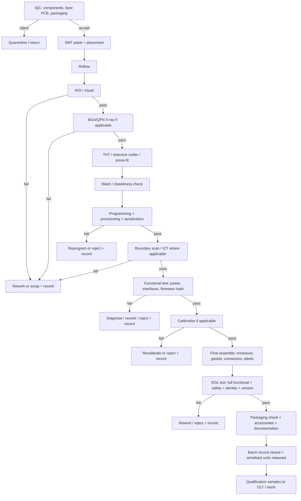

# MC-11 — D16 DFM, DFT and quality plan

| Field | Value |
|---|---|
| Document | D16 `MC11-DFM-DFT-AND-QUALITY-PLAN.md` |
| Status | `PROPOSED_NOT_APPROVED` — `INTERNAL_ENGINEERING_RESEARCH` |
| Milestone | MC-11 (deliverable 16) |
| Branch / base | `feature/marea-mc11-hardware-sourcing-conformity` / MC-10R HEAD `6713178` |
| Date | 2026-11-02 (Europe/Madrid) |
| Owner | `manufacturing-engineer` |
| Machine records | `data/qualification-plan.json`, `data/evidence/manufacturing.json` |

## 0. Status and control block (binding)

```
DESIGN                   = NONE (no schematic, layout, BOM revision or enclosure)
PROTOTYPE                = NONE EXISTS
FACTORY                  = NONE SELECTED, NONE AUDITED, NONE CONTACTED
TEST FIXTURE             = NONE DESIGNED, NONE BUILT
TEST                     = NOT_EXECUTED (all, including every test in this plan)
CALIBRATION              = NOT PERFORMED
SERIALISATION            = NOT IMPLEMENTED
PRODUCTION               = NOT_AUTHORIZED
CERTIFICATION            = NOT_ESTABLISHED
PILOT_SAFETY_GATE        = BLOCKED
```

**This is a plan, not a record.** No PCB exists, no test point exists, no fixture exists, no unit was
programmed, serialised, calibrated or tested. No factory was contacted and no supplier was audited.
Nothing here is a manufacturing capability claim. Acceptance criteria are **candidate targets** that
must be frozen at design review; they are not measured values.

---

## 1. Purpose and scope

D16 defines how a future MAREA hardware family would be designed for manufacture and test, and what
quality evidence the factory and MAREA must generate per unit and per batch. It covers:

- DFM rules that must be applied at schematic/layout review;
- the test-point and design-for-test architecture;
- boundary scan versus functional test;
- programming, provisioning and serialisation;
- calibration records and firmware traceability;
- assembly instructions, rework, incoming inspection, end-of-line test, packaging and batch records;
- the manufacturing test-flow diagram and the factory equipment list;
- per-test acceptance criteria and the quality records that prove them.

It does **not** define the product design, the BOM or the supplier. Those are open
(`HARDWARE_NOT_SELECTED`, `BOM_NOT_ESTABLISHED`, `G1 = CANDIDATE_ONLY`).

---

## 2. Design-for-manufacture (DFM) rules — candidate requirements

These are rules a future design review would enforce. They are written as requirements because no
layout exists to review.

| # | Rule | Reason |
|---|---|---|
| DFM-01 | Panelise with fiducials, tooling holes and break-away rails sized to the chosen fab's capability | Pick-and-place and AOI alignment; fab-specific |
| DFM-02 | Minimum track/space, annular ring and solder-mask sliver per the chosen fab class (capability to be confirmed, not assumed) | Yield and reliability |
| DFM-03 | Component courtyard and placement clearance for rework, probes and thermal relief | Repairability and probe access |
| DFM-04 | No component within the connector keep-out or under a shield can that cannot be reworked | Serviceability |
| DFM-05 | Thermal relief on ground pads and adequate copper for the DC/DC and protection stages | Hand/reflow solderability and thermal margin |
| DFM-06 | Polarity/orientation marks for every polarised part; unique reference designators | Assembly error prevention |
| DFM-07 | Test pads on every power rail, reset, boot-mode and debug signal (see §3) | DFT |
| DFM-08 | Isolated NMEA 0183 / field interfaces physically separated from the digital domain with a documented creepage/clearance rule | Isolation integrity (D5 §8) |
| DFM-09 | ESD protection placed at the connector, before the series element | ESD path |
| DFM-10 | Strain relief / mechanical support for connectors and cable entries; no solder-only load path | Vibration and cable-strain survival |
| DFM-11 | Enclosure and PCB co-designed: mounting holes, connector cut-outs, gasket compression, service opening | Ingress and serviceability |
| DFM-12 | Conformal-coat keep-out defined for connectors, test pads and pressure-sensitive parts | Coating vs testability conflict |
| DFM-13 | Identify any part that cannot be inspected by AOI and requires X-ray (e.g. BGA) | Inspection coverage |
| DFM-14 | Component lifecycle screen: NRND/EOL parts rejected before layout freeze (the ATECC608B candidate is already NRND) | Long-life marine product |
| DFM-15 | Second-source or approved-alternate identified for every `CRITICAL` component | Supply resilience |
| DFM-16 | Programming/debug header or pads accessible without dismantling the unit | Factory and field recovery |

None of these rules has been applied to a design, because there is no design. DFM review status:
`NOT_PERFORMED`.

---

## 3. Design-for-test: test-point and access requirements

A future board must expose the following. Named nets are illustrative of the **function**, not of any
existing schematic.

| Test access | Signal / function | Location | Required for | Acceptance use |
|---|---|---|---|---|
| TP-VIN | Raw DC input after fuse/reverse protection | Board edge | ICT/FCT | Input voltage present, reverse-protection functional |
| TP-RAILS | Each regulated rail (e.g. 5 V, 3.3 V, core rails) | Near regulator output | ICT/FCT | Rail within candidate tolerance, no short |
| TP-GND | Dedicated quiet ground reference | Distributed | All | Measurement reference |
| TP-RESET | Reset / power-good | Near supervisor | ICT/FCT | Reset tree behaves |
| TP-BOOT | Boot-mode / recovery strap | Near MCU/SoC | Programming | Recovery mode reachable |
| TP-DEBUG | SWD/JTAG or documented debug UART | Accessible with lid off | Programming/rework | Boundary scan, programming, logs |
| TP-UART | Service console UART | Service access | FCT/recovery | Boot log, version string |
| TP-COMMS | Loopback nodes for Ethernet/UART/RS-422 | Per interface | FCT | Interface loopback passes |
| TP-ANT | RF test connector or pad (AIS/WATCH) | Shielded/controlled | RF test | Conducted RF measurement |
| TP-CAL | Calibration reference node (SENSE) | Near sensor front end | Calibration | Reference injection, record |
| TP-ESD | ESD test points at user connectors | At each connector | ESD pre-test | Discharge path verified |
| TP-CURRENT | Current-measurement jumper / shunt | Power tree | Power measurement | Consumption measured, not estimated |

**Rule:** a test point that is not probe-accessible in the final assembly is a factory-only test point
and must not be presented as a field diagnostic. Field diagnostics are limited to what the firmware
exposes through a documented service interface (D18 §7).

---

## 4. Boundary scan versus functional test

| Aspect | Boundary scan (JTAG/IEEE 1149.1-class) | Functional test (FCT) | In-circuit test (ICT, bed-of-nails/flying probe) |
|---|---|---|---|
| What it proves | Interconnect opens/shorts, some device presence, programming access | The assembled unit performs its function | Component presence/value and some interconnect |
| Coverage | Structural, limited to scan-chain devices | Behavioural, as good as the test cases | Structural, limited by probe access |
| Fixture | Low (connector/header) | Medium–high (harness, loads, instruments) | High (fixture per board) |
| Design impact | Scan-chain devices, accessible JTAG, chain continuity | Test hooks, service UART, controllable loads | Test pads, probe clearance, no coating over pads |
| Suitable for | Digital-heavy HUB/DISPLAY logic; programming | Every family's end-of-line gate | Volume PCBA (100+) |
| Not suitable for | Analogue front ends, RF, power stages | Structural faults only | Low volume; high-mix |
| Requirement state | Candidate; no scan chain designed | Candidate; required at EOL | Candidate; volume-dependent |

**Proposed strategy (candidate, not approved):**

1. **Prototype / 1–10 units:** programming via debug header, functional test with a bench harness,
   visual inspection, manual serialisation. No ICT.
2. **100 units:** boundary scan where the chosen processor supports it + a functional test fixture
   covering power, interfaces and firmware version. Flying-probe or ICT if the CEM offers it.
3. **1 000 units:** ICT or flying probe + boundary scan (if applicable) + automated FCT + calibration
   + EOL. Test time and fixture NRE must be measured, not assumed.

No fixture design, test program or coverage figure exists. Any claimed coverage percentage would be
invented.

---

## 5. Programming fixture and secure provisioning (candidate)

| Element | Candidate requirement | Status |
|---|---|---|
| Fixture | Pogo-pin or connector-based programming jig with keyed, non-reversible contact | NOT_DESIGNED |
| Interface | SWD/JTAG or documented bootloader port; no reliance on a removable SD card | NOT_DESIGNED |
| Image | Signed firmware image; programming tool verifies the signature before writing | NOT_IMPLEMENTED |
| Device identity | Per-device key/certificate injected at programming; no shared default credential | NOT_IMPLEMENTED |
| Identity binding | Serial number ↔ public key/device certificate ↔ MAC/serial ↔ test record | NOT_IMPLEMENTED |
| Rollback protection | Anti-rollback counter/version policy | NOT_IMPLEMENTED |
| Test mode | A factory test mode that is disabled/locked before shipping | NOT_DESIGNED |
| Log | Programming station logs device ID, firmware hash, operator/tool version, timestamp, result | NOT_IMPLEMENTED |
| Security boundary | Keys generated/held per device; production key material not in the firmware image | NOT_DESIGNED |

**Hard rule:** a shipped unit must not have a shared default password or key (DISPLAY §14.1). Key
management and secure provisioning are security workstream items (D27); this document only requires
that the factory step exists and is recorded.

---

## 6. Serialisation and identity

| Record field | Example form (not a real value) | Purpose |
|---|---|---|
| Device serial | `FAMILY-YYWW-NNNNN` | Unique unit identity |
| PCBA serial | board-level serial or panel position | Trace a board to a panel/batch |
| Batch / lot | fab/assembly lot, date code | Recall boundary |
| MAC / radio ID | assigned and recorded | Network identity |
| Device public key / cert ID | provisioned at programming | Secure identity (D27) |
| Firmware version + hash | signed build identifier | Reproduce exactly what shipped |
| Calibration record ID | per sensor/unit | Measurement traceability |
| Test record ID | EOL result set | Quality evidence |
| Packaging/box ID | carton/pallet | Logistics trace |

**Rule:** a unit without a resolvable serial → batch → firmware → test record chain is not
traceable, and traceability is a legal obligation for a consumer product (GPSR traceability;
`HARDWARE-COMPLIANCE-MATRIX.md` §5.5). No serialisation scheme exists.

---

## 7. Calibration records (SENSE, WATCH, DISPLAY where applicable)

| Family | What is calibrated | Reference class needed | Record | Status |
|---|---|---|---|---|
| SENSE-POWER | Voltage/current measurement chain | Traceable reference meter and known load | `SENSE-POWER` expects calibration state per value (D8 §3.2) | NOT_PERFORMED, no fixture, no reference equipment booked |
| SENSE-WIND | Wind speed/angle | Reference anemometer / known angle | Calibration state and procedure | NOT_PERFORMED |
| SENSE-TANKS | Level vs sender characteristic | Fill/empty characterisation | Per-tank calibration record | NOT_PERFORMED |
| SENSE-ENV | Temperature/humidity/pressure | Calibrated environmental reference | Calibration record | NOT_PERFORMED |
| SENSE-BILGE | Digital switch state | Wetting current and open/short detection | Test record | NOT_PERFORMED |
| WATCH | Sensor inputs and backup-energy health | Reference meter/load | Record | NOT_PERFORMED |
| DISPLAY | Touch/panel/backlight (if claimed) | Photometric and touch reference | Record | NOT_PERFORMED |

**Rule:** the product may show "calibrated / uncalibrated / out of range" but may **not** publish an
accuracy figure until a traceable comparison has been executed and recorded (D8 §3.3). A calibration
record is a dated, attributable artefact, not a checkbox.

---

## 8. Firmware traceability

| Requirement | Detail | Status |
|---|---|---|
| Reproducible build | Build from a pinned source revision; recorded toolchain versions | NOT_IMPLEMENTED |
| Firmware hash | SHA-256 (or equivalent) of the shipped image, recorded per unit | NOT_IMPLEMENTED |
| Signed image | Signature verified by the device at boot/update | NOT_IMPLEMENTED |
| Version string | Visible to owner and in the diagnostic record (DISPLAY §13.8) | NOT_IMPLEMENTED |
| SBOM | Machine-readable component inventory for CRA readiness | NOT_FOUND (`H-13`) |
| Build metadata | Build date, commit, configuration flags | NOT_IMPLEMENTED |
| Update record | Which update was applied, when, result | NOT_IMPLEMENTED |
| Programming log | Device ID + image hash + station + time + result | NOT_IMPLEMENTED |

**Rule:** "same firmware version" is not the same as "same firmware image". The record must identify
the image by hash, not only by a marketing version number.

---

## 9. Assembly instructions and workmanship

| Document | Required content | Status |
|---|---|---|
| Work instruction | Per-station steps, torque values, connector seating, gasket placement, coating mask, labels | NOT_WRITTEN |
| Visual standards | Solder fillet, cleanliness, no-clean residue, connector orientation | NOT_WRITTEN |
| ESD control | Grounded bench, wrist strap test, packaging | NOT_WRITTEN |
| Torque/thread | Screw type, torque, thread-locking, order | NOT_WRITTEN |
| Sealing | Gasket compression, cable-gland torque, sealing method | NOT_WRITTEN |
| Labelling | Serial, model, certification marks (only when legally allowed), warnings | NOT_WRITTEN |
| Packaging | Box, insert, desiccant, ESD bag, documentation | NOT_WRITTEN |

**Workmanship reference (named candidate, not adopted):** IPC-A-610 (acceptability of electronic
assemblies) and IPC J-STD-001 (soldering requirements) are the common industry references; neither
document was retrieved in this session and no acceptance class (Class 1/2/3) is chosen. Naming them is
not a certification claim.

---

## 10. Rework process (candidate)

| # | Rule | Reason |
|---|---|---|
| RW-01 | Rework only by a trained operator at an ESD-protected station | Damage/prevention |
| RW-02 | Maximum reflow cycles per board documented (industry practice commonly limits to 2; must be fixed with the CEM, not assumed) | Laminate and component stress |
| RW-03 | BGA/QFN rework only with a documented thermal profile and X-ray verification | Hidden joints |
| RW-04 | Every rework recorded: board serial, reference designator, cause, action, operator, result | Traceability and yield analysis |
| RW-05 | Conformal coat removed and restored around rework per written procedure | Coating integrity |
| RW-06 | No rework on safety-relevant or calibrated assemblies without re-test and recalibration | Safety and measurement integrity |
| RW-07 | Scrap criteria defined; a reworked board cannot be labelled as new without record | Honest quality record |

No rework procedure exists; no board exists.

---

## 11. Incoming inspection (IQC)

| Check | Method | Acceptance (candidate) | Evidence |
|---|---|---|---|
| Component authenticity | Authorised-channel purchase records; visual; marking check | No broker/channel ambiguity for critical parts | Purchase record per batch |
| MSL / packaging | Moisture-barrier bag, humidity indicator, date code | Per MSL label; no expired floor life | IQC record |
| Damage | Visual, packaging condition | No crushed/reflowed/damaged parts | IQC record |
| Board quality | Visual; coupon/ impedance report where offered | Fab spec met | Fab certificate + coupon |
| Counterfeit indicators | Marking/date-code consistency; X-ray/ROHS XRF where available | No anomaly unresolved | IQC record |
| RoHS/material declarations | Supplier declaration | Declaration held; not a compliance claim for the assembly | Document |
| Quantity/reel | Count, reel labelling | Matches order | IQC record |
| Firmware/part marking | Compare to BOM revision | Exact MPN, no substitution without approval | IQC record |

No IQC plan exists and no incoming material was inspected.

---

## 12. Manufacturing test-flow diagram



**Gates that cannot be skipped:** IQC, programming/provisioning log, firmware-hash verification,
calibration (where applicable), EOL test, packaging check, batch record. A unit that skips a gate is
not releasable, regardless of who built it.

---

## 13. Acceptance criteria per test stage (candidate; freeze at design review)

| Stage | What is measured | Candidate acceptance criterion | Failure action |
|---|---|---|---|
| IQC | Incoming conformity | Matches approved BOM revision and datasheet identity | Quarantine |
| AOI | Solder/placement defects | No defect outside the agreed IPC-A-610 class (class to be chosen) | Rework/scrap |
| X-ray | Hidden joints | No void/open outside agreed limit | Rework/scrap |
| Boundary scan | Interconnect | Chain intact; no open/short on scanned nets | Diagnose |
| ICT | Component/interconnect | Opens/shorts/values within window | Rework |
| Programming | Image + identity | Signature valid; hash matches release; unique key provisioned | Reject |
| Functional test | Power, boot, interfaces | Rails within agreed tolerance; boot within agreed time; loopback passes | Diagnose |
| Firmware hash | Provenance | Device-reported hash = release manifest hash | Reject |
| Calibration | Measurement chain | Within the (not yet defined) calibration tolerance; record dated | Recalibrate/reject |
| EOL functional | Full declared function | Every declared function passes; no stale/unknown state presented as valid | Rework/reject |
| EOL identity | Serial/keys/MAC | Unique; bound to record; no default credential | Reject |
| Power-loss behaviour | Boot/recovery | Recovers to known state; no corruption (candidate) | Diagnose |
| Storage health | eMMC/SD | Reported health within limit (candidate) | Reject |
| Packaging | Contents/condition | All accessories, documentation, labels, no damage | Repack |
| Batch record | Completeness | Every serial has IQC, programming, test, calibration, EOL, packaging records | Block release |

**Tolerance values are deliberately absent.** They must be derived from the design and measured on a
first article; inventing a voltage tolerance, boot time or calibration limit in MC-11 would be a false
acceptance criterion. Each will be fixed and dated at design freeze.

---

## 14. End-of-line (EOL) test

The EOL test is the last gate before a unit becomes a product. Candidate content:

1. **Identity:** serial readable, matches the record, no default credential.
2. **Version:** firmware version and hash reported and matched to the release manifest.
3. **Power:** input across the candidate window (D5 §1), no damage, rails in regulation.
4. **Function:** every declared interface exercised with a loopback or simulator; every declared
   function observed.
5. **Honesty checks:** disconnected source shows stale/unknown, never a fabricated value (the product's
   core promise).
6. **Recovery:** a documented power interruption and restart; update/recovery path exercised where the
   design allows.
7. **Thermal sanity:** device reports its own temperature/state honestly (not a thermal specification).
8. **Calibration:** current calibration state visible and correct.
9. **Mechanical:** connectors seated, gasket intact, no loose hardware, labels present.
10. **Record:** result, operator/station, time, firmware hash written to the batch record.

No EOL station, test procedure or result exists.

---

## 15. Packaging checks

| Check | Acceptance (candidate) |
|---|---|
| Box/insert fit | No movement; connector/antenna protected |
| ESD protection | Board/unit in ESD-safe packaging if exposed |
| Moisture protection | Desiccant/barrier where required by the route |
| Accessories | Antenna, cable, mounting, documentation present per SKU list |
| Documentation | Safety/warning/installation text in the required language(s) |
| Labels | Serial, model, warnings, and **only** legally permitted marks |
| Market-specific | No CE mark before a DoC exists; no IP/temperature/EMC rating before test |
| Drop/transport | Packaging validation to be defined (test not executed) |

Packaging design, cost and validation are `UNKNOWN`; no packaging supplier was contacted (register:
zero PACKAGING suppliers fetched).

---

## 16. Batch records and traceability

A batch record must link, for every serialised unit:

```
serial -> PCBA batch/panel -> component lots (critical) -> programming image hash
       -> calibration record -> functional test result -> EOL result
       -> packaging/box -> shipment/customer (as legally required) -> service history (D18)
```

| Record | Owner | Retention (candidate; legal minimum not yet established) |
|---|---|---|
| IQC record | Factory / MAREA QC | At least product life + statutory period |
| Programming log | Factory / MAREA | As above |
| Test results (FCT/EOL) | Factory / MAREA | As above |
| Calibration record | MAREA | As above |
| Rework record | Factory | As above |
| Batch release | MAREA QC | As above |
| Shipment record | MAREA | As above |

**No retention period is asserted as a fact.** The statutory retention for the technical file and
traceability must be confirmed by the conformity/legal workstream (D24, D26); MC-11 records it as
`UNKNOWN`.

---

## 17. Equipment the factory would need

| Equipment | Purpose | Route stage |
|---|---|---|
| SMT printer + pick-and-place + reflow | Board assembly | R2/R3/R5 partner |
| AOI | Solder/placement inspection | R2/R3/R5 partner |
| X-ray | Hidden joints (BGA/QFN) | partner, if applicable |
| ICT / flying probe | Structural board test | 100+ units |
| Boundary-scan controller | JTAG interconnect/programming | optional |
| Programming/provisioning jig | Firmware + identity injection | MAREA (R6) |
| Bench PSU (programmable) | Power, voltage sweep | MAREA / partner |
| Electronic load | Current/consumption measurement | MAREA |
| DMM (calibrated) | Voltage/current/resistance | MAREA |
| Oscilloscope + probes | Reset, power sequencing, interfaces | MAREA |
| Serial/USB/Ethernet test harness | Interface loopback | MAREA |
| RF test set / spectrum analyser (AIS, WATCH) | Conducted RF checks | specialist/lab |
| Calibration reference equipment | SENSE/WATCH calibration | MAREA/lab |
| ESD test gun + test setup | Pre-compliance ESD | lab/partner |
| Leak/ingress test rig | Sealing check (D17 IP test is a lab test) | lab |
| Thermal chamber | Not a factory item; qualification lab | lab |
| Vibration/shock rig | Not a factory item; qualification lab | lab |
| Labelling/scan station | Serial + traceability | MAREA |
| ESD bench + wrist-strap tester | Assembly/rework | MAREA/partner |

No equipment was procured, booked or quoted. Equipment cost is `UNKNOWN`.

---

## 18. Quality metrics — what can and cannot be stated

| Metric | Status |
|---|---|
| First-pass yield (FPY) | `UNKNOWN` — no batch exists |
| Defects per million opportunities (DPMO) | `UNKNOWN` |
| Scrap rate | `UNKNOWN` |
| Rework rate | `UNKNOWN` |
| Field failure rate | `UNKNOWN` — no field population |
| Test coverage | `UNKNOWN` — no board, no fixture, no coverage tool |
| Calibration yield | `UNKNOWN` |

No target is presented as achieved. Targets may only be set when the design and the test coverage
exist, and any yield figure used in a cost model must carry its measured basis and date.

---

## 19. Relationship to the other deliverables and gates

| Item | Relationship |
|---|---|
| D15 manufacturing routes | Determines **who** performs each stage; D16 defines **what** they must produce |
| D17 environmental reliability | Consumes the serialised, tested units this plan produces; qualification samples are drawn from a controlled batch |
| D18 service/warranty/RMA | Depends on the serialisation, traceability and diagnostic records defined here |
| D24 CE/EMC/RED roadmap | Defines the accredited test route; D16 provides the production evidence that supports it |
| D27 device security | Owns secure provisioning, key management and signed update; D16 provides the factory step |
| Gates G2–G4, G7 | No factory engagement, prototype build or production release is authorised |

---

## 20. Explicit control statements

```
DESIGN_REVIEW_PERFORMED     = NO (no design)
DFM_REVIEW                  = NOT_PERFORMED
DFT_REVIEW                  = NOT_PERFORMED
TEST_FIXTURE                = NONE
FIRST_ARTICLE_INSPECTION    = NOT_PERFORMED
CALIBRATION                 = NOT_PERFORMED
SERIALISATION               = NOT_IMPLEMENTED
BATCH_RECORD                = NONE
FACTORY_AUDIT               = NOT_PERFORMED
PRODUCTION                  = NOT_AUTHORIZED
```

Every acceptance criterion in this document is a **candidate requirement**. None is a measured result.
